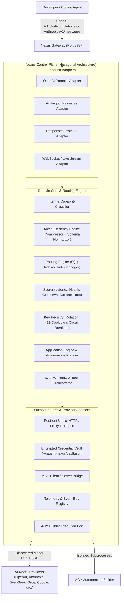
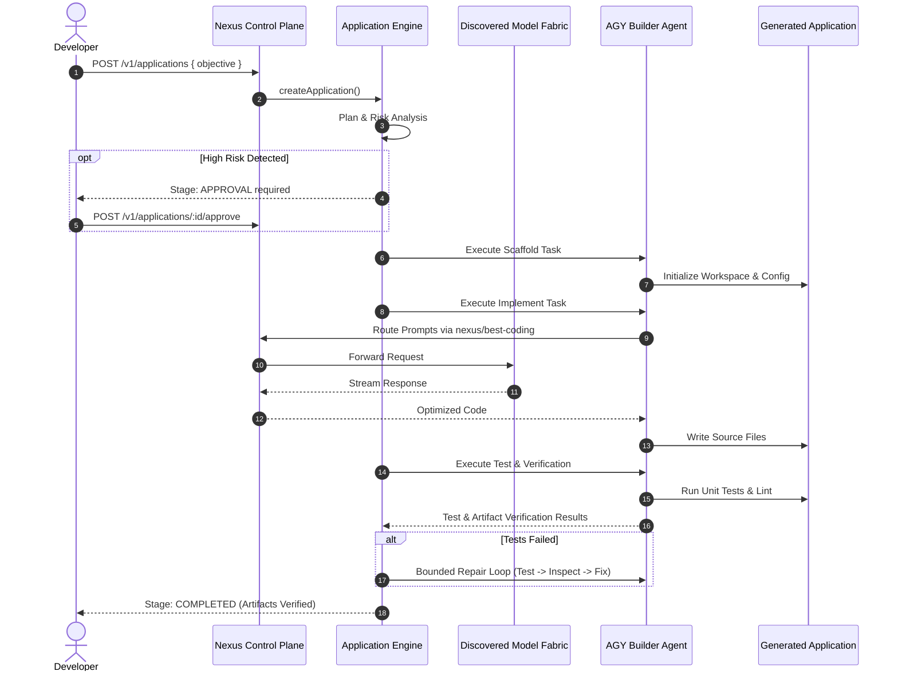
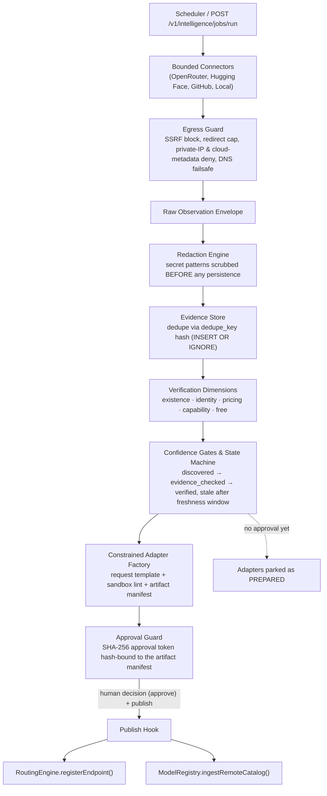

# Nexus Architecture & System Design

Nexus is a **local-first Universal AI Coding-Agent Gateway and Autonomous Control Plane**. It serves as the intelligent infrastructure layer between developer coding agents (Claude Code, Codex, OpenCode, Gemini CLI, Cursor, AGY) and multi-provider model APIs (OpenAI, Anthropic, DeepSeek, Google, Groq, Mistral, xAI, OpenRouter, Cerebras, Together, Fireworks, NVIDIA NIM).

---

## 1. High-Level Data Flow



---

## 2. Hexagonal Architecture (Ports & Adapters)

Nexus is organized following pure Clean / Hexagonal Architecture patterns:

### Core Domain (Inner Layer)
- **`packages/core`**: Pure domain logic, domain types, entities, policies, and port interfaces. Zero dependency on Fastify, HTTP servers, or external SDKs.
  - `ModelRegistry`: Aggregates dynamic models, tracks catalog versions, emits delta events.
  - `RoutingEngine`: Implements cost/latency/quality routing algorithms (`FREE`, `CHEAP`, `FAST`, `BEST`, `BEST-CODING`, `REASONING`, `VISION`, `LONG_CONTEXT`).
  - `KeyRegistry`: Multi-key rotation, 429 exponential cooldown, 401 disablement, circuit breakers.
  - `ApplicationEngine`: Autonomous software planning, scaffolding, verification, and repair cycle.
  - `AutonomousPlanner` & `RiskEngine`: Analyzes intent and enforces user approval for high-risk operations.

### Inbound Adapters (Driving Ports)
- **`apps/gateway`**: Fastify REST & WebSocket HTTP server exposing standard endpoints (`/v1/chat/completions`, `/v1/messages`, `/v1/models`, `/v1/catalog`, `/v1/applications`, `/v1/doctor`).
- **`packages/cli`**: CLI binary (`anx-gateway`) providing diagnostic and management subcommands.

### Outbound Adapters (Driven Ports)
- **`packages/providers`**: Direct REST/SSE transport implementations for all AI providers.
- **`packages/security`**: AES-256-GCM encrypted local vault, PBKDF2 key derivation, token hashing.
- **`packages/token-efficiency`**: Token counter, prompt compressor, context cache tagger, tool-schema normalizer.
- **`packages/networking`**: Proxy transport (HTTP/HTTPS/SOCKS5), DNS resolution, egress diagnostics.
- **`packages/observability`**: Telemetry ring buffers, latency percentile calculators (p50/p95/p99), event bus.
- **`packages/mcp-server` & `packages/mcp-client`**: Model Context Protocol client/server integration.

---

## 3. Subsystem Breakdown

| Subsystem | Responsibility |
|---|---|
| **Protocol Adapter** | Bidirectional translation between OpenAI format and Anthropic Messages format. |
| **Universal Model Fabric** | Normalizes discovered models across context size, pricing, speed, capability tags, and modality. |
| **Model Registry** | Dynamic background and on-demand model discovery. Increments `catalogVersion` and publishes delta changes (ETag/304). |
| **Routing Engine** | O(1) indexed candidate lookup matching requests against configured routing policies and model capabilities. |
| **Key Registry** | Per-provider multi-key rotation, rate limit isolation, and automatic failover escalation. |
| **Token Efficiency Engine** | Exact-duplicate deduplication, tool schema normalization, and context compaction reporting measured savings. |
| **Autonomous Application Engine** | Manages application build lifecycle: Discover → Specify → Architect → Plan → Approval → Scaffold → Build → Test → Verify → Repair → Finalize. |
| **AGY Builder Port** | Controlled execution port for AGY subprocess actions in isolated workspaces. |
| **AI Provider Intelligence** | Continuous provider/model discovery via bounded connectors, redaction-first evidence, independent verification dimensions, free-tier intelligence, leak monitoring (redacted), hash-bound human approval and approved-only adapter publishing (`packages/intelligence`, discovery subsystem #15 in the health hierarchy). |
| **Mission Control Dashboard** | Next.js 15 / React 19 operational UI for real-time traffic, provider configuration, model catalog, and metrics. |

---

## 4. AGY Application Builder Architecture



---

## 5. Security & Isolation Boundaries

- **Credential Vault**: Keys are encrypted at rest in `~/.agent-nexus/vault.json` using AES-256-GCM. Keys are never logged or echoed back.
- **Workspace Isolation**: AGY execution tasks operate within sandbox paths with explicit forbidden path guards preventing modification of the Nexus repository or system roots.
- **Security Fabric**: Strips authentication headers from outgoing responses and applies `X-Content-Type-Options: nosniff` and `Cache-Control: no-store`.

---

## 6. Phase 29: Unified Agent Mission Orchestration Fabric

Phase 29 introduces autonomous mission decomposition and DAG orchestration above individual coding agents:

```mermaid
flowchart TD
    User([User Objective]) --> MissionCtrl[Mission Control API]
    MissionCtrl --> Planner[Mission Planner]
    Planner --> RiskEngine{Risk Gate}
    RiskEngine -->|High/Critical| Approval[Awaiting Operator Approval]
    RiskEngine -->|Low/Medium| DAG[Mission Task DAG]
    Approval -->|Approved| DAG
    
    DAG --> T1[Task 1: Analysis]
    DAG --> T2[Task 2: Architecture]
    DAG --> T3[Task 3: Backend Coding]
    DAG --> T4[Task 4: Test Suite Gen]
    
    T1 & T2 & T3 & T4 --> Orch[Agent Orchestrator]
    Orch --> MultiAgent[Claude Code / Codex / Hermes / OpenCode / AGY / Gemini]
    MultiAgent --> ModelFabric[Nexus Model Fabric & Provider Routing]
    
    T3 & T4 --> RepairLoop{Test Failure?}
    RepairLoop -->|Yes (<= 3 attempts)| AutoRepair[Autonomous Repair Loop]
    AutoRepair --> Orch
    RepairLoop -->|No| Verifier[Mission Verifier]
## 7. Phase 32: Durable Persistence, Crash Recovery & Health Hierarchy

Phase 32 transforms Nexus into an ACID-compliant, crash-recoverable AI control plane (the health hierarchy has since grown from 14 to 15 subsystems with the discovery subsystem, see §9):

```mermaid
flowchart TD
    subgraph INGRESS ["Ingress & Fastify Server"]
        HTTP["HTTP / SSE Ingress (Port 8787)"]
        HealthAgg["Health Aggregator (15 subsystems)"]
    end
    
    subgraph DURABLE ["Durable Persistence & Recovery Engine (@anx/persistence & @anx/core)"]
        SQLite["ACID SQLite WAL Store / AtomicJsonStore"]
        Migrations["SchemaMigrationManager (v1 -> v2)"]
        Idempotency["DurableIdempotencyStore (SHA-256 Hashing)"]
        Recovery["CrashRecoveryEngine (Startup Reconciler)"]
        Checkpoints["Mission Checkpoints & Task Recovery"]
        Backup["BackupRestoreEngine (Cryptographic Bundles)"]
    end
    
    subgraph AGENTS ["Universal Local Agent Bridge"]
        Pool["Agent Pool & Lease Manager"]
        ProcessGuard["Subprocess PID Liveness & Orphan Reaper"]
    end
    
    HTTP --> Idempotency
    HTTP --> Recovery
    Recovery --> SQLite
    Recovery --> Checkpoints
    Recovery --> ProcessGuard
    ProcessGuard --> Pool
    Migrations --> SQLite
    Backup --> SQLite
```

### Complete End-to-End Data Flow

```
Provider
 ↓
Encrypted Credential Vault (AES-256-GCM)
 ↓
Provider Discovery (Dynamic API Sync)
 ↓
Model Discovery & Normalization
 ↓
Model Registry (Dynamic Catalog)
 ↓
Capability Index (Tool, Vision, Reasoning)
 ↓
Routing Engine (5-Dimension Multi-Factor Scoring)
 ↓
Failover & Key Rotation (429 Cooldown)
 ↓
Universal Local Agent Bridge (Claude Code, Codex, Hermes, OpenCode, AGY, Gemini)
 ↓
Mission Orchestrator (Topological DAG Scheduling)
 ↓
Agent Execution (Subprocess & Workspace Sandbox)
 ↓
Verification (Syntax, Lint, Unit Tests)
 ↓
Durable Persistence (SQLite ACID & Checkpoints)
 ↓
Recovery & Observability (Startup Reconciler & Telemetry Ring Buffer)
```

---

## 9. AI Provider Intelligence OS

The Intelligence OS is an optional, self-contained subsystem (`packages/intelligence`, `@anx/intelligence`) that continuously discovers AI providers and models from public sources, verifies claims against evidence, monitors for credential leaks, and prepares integrations — while guaranteeing that **nothing reaches production routing without a human-approved, hash-bound publish**. It appears as the `discovery` subsystem (#15) in the health hierarchy, reported by `SystemHealthAggregator` when `HttpServerDeps.intelligence` is wired in the gateway runtime.

### Discovery → Publish pipeline



### Boundary invariants

1. **Discovery is isolated from production.** Connectors write only to the intelligence store; production routing is mutated exclusively by the publish hook after an approval.
2. **Redaction-first.** Fetched content is scanned for secret patterns (API keys, tokens, bearer strings) before it is persisted or hashed. Detected leaks are stored redacted and are never tested against live endpoints.
3. **Untrusted content is data.** Provider API responses, READMEs and any fetched text are recorded as evidence payloads only — never executed, followed, or treated as instructions.
4. **Free is never inferred by omission.** Missing pricing stays `unknown`; `free=true` requires an explicitly documented access plan, and the claim goes `stale` once its pricing freshness window (7 days) expires.
5. **Independent verification.** Existence, identity, pricing and capability are separate dimensions with separate evidence; a healthier dimension cannot endorse a claim dimension that has no evidence of its own.

### RBAC, audit & gateway surface

Routes live under `/v1/intelligence/*` (deliberately excluded from `PUBLIC_PREFIXES`), reply `503 NOT_CONFIGURED` when the engine is absent, and are gated by four permissions:

| Permission | Operations |
|---|---|
| `intelligence:discover` | Enqueue / trigger discovery job runs |
| `intelligence:write` | Request verification runs, change finding status, prepare adapters |
| `intelligence:approve` | Submit approval decisions (approve / reject with note) |
| `intelligence:publish` | Publish an approved adapter to routing |

Every mutation is audited (`intelligence.jobs.enqueued`, `intelligence.verification.requested`, `intelligence.finding.status_changed`, `intelligence.adapter.published`).

### Publish binding

- `POST /v1/intelligence/adapters/prepare` generates a constrained adapter candidate (request template, sandbox lint) plus an artifact manifest.
- `POST /v1/intelligence/approvals/:id/decision` and `POST /v1/intelligence/adapters/:id/publish` re-verify that the SHA-256 approval token still matches the manifest. Artifact drift yields `409 ARTIFACT_DRIFT`, wrong state `409 NOT_PENDING`, missing adapter `404 ADAPTER_MISSING`, denied principal `403`.
- On publish the gateway registers the endpoint with `RoutingEngine` and ingests the catalog into `ModelRegistry`; the intelligence engine itself never sits in the request hot path.

### Storage

Intelligence state lives in its own `intelligence_*` SQLite tables inside the shared local store (`~/.agent-nexus/nexus.db`, or `NEXUS_DB_PATH`) via `node:sqlite`, with an in-memory repository fallback when SQLite is unavailable.

